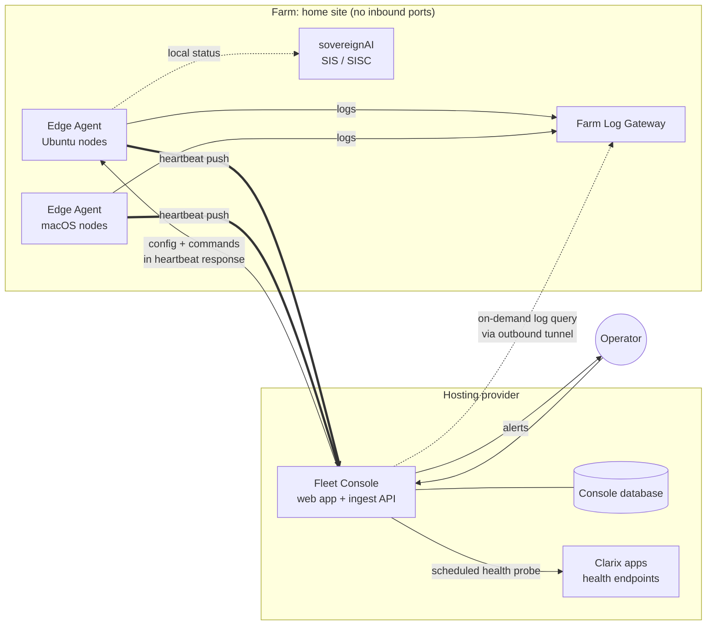

# ARCH-001: Fleet Console — Solution Architecture

| | |
|---|---|
| Status | Draft for build, REV A |
| Date | 2026-11-24 |
| Owner | Bill (Architect / Product Owner) |
| Audience | Lead Engineer (Claude Code) |
| Companion | `USER-STORIES.md`, `stories/` |

"Fleet Console" is a working title. Naming is an open decision (OD-1).

## 1. Purpose

One hosted web application that shows the current state and recent performance of everything Bill operates: the machines at home, the sovereignAI platform running on them, and the Clarix applications hosted on Vercel.

The console must keep working when the home site is down. A home outage is the event it most needs to report.

## 2. Decision rights

This document describes and defines. It fixes outcomes, boundaries, contracts, and constraints.

The Lead Engineer owns design, technology selection inside the stated constraints, implementation, test, and deployment. Where this document names a technology, it is a constraint. Where it describes a capability, the choice belongs to the Lead Engineer. Section 15 holds non-binding notes.

Any change to a contract in sections 7 to 9 or a principle in section 5 comes back to the Architect before build.

## 3. Scope

**In scope**

- Hosted web console: fleet overview, node detail, hosted-app detail, sovereignAI view, alerts, administration.
- Edge Agent for each home machine: install, configure, upgrade, remove.
- Farm Log Gateway: on-demand log queries from the console without persisting log content in the console.
- Hosted-app health probing against a defined health contract.
- Full lifecycle for a node and for a whole farm: enroll, change configuration, remove.

**Out of scope for this release**

- Distributed tracing and request-level performance analysis.
- Long-term log storage or log search inside the console's own database.
- Remote command execution on nodes beyond the fixed command set in section 8.
- Automated remediation (restart, failover, scaling).
- Deployment or hosting of applications on the home farm.
- Multi-tenant commercial use. The data model carries organisation ownership; the product is built for one operator.

## 4. Context

### 4.1 Facts

- Home machines run Ubuntu 24.04 LTS (HP and Dell hardware) and macOS (Mac mini, MacBook Pro). The fleet is five to eight machines and will change.
- Hostnames are being standardised and will be renamed. A machine's identity cannot depend on its hostname.
- The home network is residential: no static address, no inbound ports open, consumer mesh Wi-Fi moving to wired.
- sovereignAI runs on the home fleet as three services: SIS (inference), SISC (gateway/controller), and a console. Source is in the repository `WB72_SoveriegnAI_Server`.
- Clarix applications (ECP, EDL, ERR, MMP, MIA) and styleOS are hosted on Vercel with Postgres on Neon. ECP has live users.
- Some Ubuntu machines run containers; others run services directly under the operating system's service manager.

### 4.2 Assumptions

Each is a default the Lead Engineer may build against. Bill confirms or corrects.

| ID | Assumption |
|---|---|
| A-1 | The console is hosted on Vercel with Postgres on Neon, consistent with the Clarix applications. |
| A-2 | One operator, one organisation, one farm at launch. More farms are possible later. |
| A-3 | The MacBook Pro is a node and is expected to be intermittently offline. |
| A-4 | Email is the launch notification channel. |
| A-5 | Raw telemetry is kept 30 days; hourly rollups are kept 13 months. |
| A-6 | Hosted applications can each add one health endpoint. |

## 5. Architecture principles

1. **Outbound only.** No node accepts an inbound connection from the internet. All node-to-console traffic is initiated by the node over HTTPS. The Log Gateway is reachable only through a tunnel it establishes outbound.
2. **Silence is a signal.** The console infers failure from missing heartbeats. A node never has to report its own death.
3. **State in the console, logs at the source.** The console stores state, coarse metrics, and short error tails. Full log content stays where it was written and is fetched on demand.
4. **Declared configuration.** The console holds the desired configuration for every node. Nodes converge to it and report what they applied.
5. **No remote shell.** The console can issue only the fixed commands in section 8. It can never run arbitrary code on a node.
6. **Reversible by design.** Everything installed can be reconfigured and removed cleanly, for one node or a whole farm, online or offline.
7. **Light on the node.** The agent must be negligible next to the workloads it observes.

## 6. Domain model

| Concept | Definition |
|---|---|
| Organisation | Owner of everything below. One at launch. |
| Farm | A named group of nodes at one site sharing one Log Gateway. Example: `home-kennewick`. |
| Node | One machine running an Edge Agent. Has a generated, permanent identity; hostname, addresses, and hardware are attributes that may change. |
| Service | A unit of work on a node the operator cares about: an OS-managed service, a container, or a sovereignAI component. |
| Hosted App | An application running on a hosting provider, observed through its health endpoint. |
| Snapshot | One telemetry report from a node at a point in time. |
| Desired Config | The versioned configuration the console wants a node to run. |
| Command | One instruction from the fixed set, queued for a node. |
| Alert | A detected condition with an open and close time. |
| Audit Event | A record of a lifecycle or administrative action. |

Node status values: `pending` (enrolled, no heartbeat yet), `healthy`, `degraded` (reporting, with a failing check), `stale` (missed heartbeats), `expected-offline` (intermittent node, currently silent), `decommissioning`, `removed`.

## 7. Components

### 7.1 Fleet Console (hosted)

Responsibilities:

- Authenticate the operator.
- Accept telemetry from nodes through an ingest interface; validate, authorise, store.
- Hold desired configuration and the command queue for each node; deliver both in heartbeat responses.
- Probe hosted apps on a schedule.
- Detect staleness and threshold breaches; raise, close, and notify alerts.
- Present fleet, node, app, and sovereignAI views.
- Proxy on-demand log queries to the Farm Log Gateway and the hosting provider; stream results; persist none of them.
- Administer farms, nodes, apps, credentials, and retention.
- Record audit events.

### 7.2 Edge Agent (one per node)

Responsibilities:

- Enrol once using a single-use token; hold a node-specific credential afterward.
- Collect host vitals, service states, and sovereignAI status where present.
- Push a Snapshot at the configured interval.
- Buffer Snapshots during connectivity loss and forward them on recovery.
- Fetch and apply Desired Config; report the applied version or the reason it was rejected.
- Execute Commands from the fixed set.
- Ship local logs to the Farm Log Gateway.
- Provide a local command-line interface for status, connectivity test, configuration display, and removal.
- Run under the operating system's native service manager, start at boot, restart on failure.

Supported platforms at launch: Ubuntu 24.04 LTS (x86-64) and current macOS on Apple silicon.

### 7.3 Farm Log Gateway (one per farm)

Responsibilities:

- Receive logs from the farm's agents and hold them at the farm with bounded retention.
- Answer read-only queries by node, service, time range, severity, and text filter.
- Be reachable from the console only through an outbound-established tunnel, authenticated with a service credential.
- Report its own health through the agent on its host node.

### 7.4 Hosted App health endpoint

A small endpoint each hosted app exposes, conforming to the contract in section 9.3. The console calls it; the app does not call the console.

## 8. Communication flows

### 8.1 Heartbeat (node to console)

1. The agent assembles a Snapshot and sends it with its node credential.
2. The console validates the credential, schema version, and payload size; stores the Snapshot; updates node status.
3. The console's response carries: the current Desired Config version, and any queued Commands.
4. If the config version differs from what the agent runs, the agent fetches the new config, validates it, applies it, and reports the outcome in its next Snapshot.

Defaults: 60-second interval, configurable from 30 to 300 seconds per node. A node is `stale` after three missed intervals.

### 8.2 Commands (console to node, delivered in the heartbeat response)

The complete command set:

| Command | Effect |
|---|---|
| `decommission` | Agent stops reporting, removes itself and all its artifacts from the node, and confirms before exiting. |
| `rotate-credential` | Agent exchanges its credential for a new one; the old one is revoked on confirmation. |
| `upgrade` | Agent updates itself to the version named in the command and reports the new version. |
| `refresh-config` | Agent re-fetches and re-applies Desired Config. |

No other command exists. Adding one is an architecture change.

### 8.3 Log query-through (operator to source)

1. The operator opens logs for a node, service, or hosted app and sets filters.
2. The console authorises the request and forwards the query to the Farm Log Gateway or to the hosting provider's log interface.
3. Results stream to the browser. The console writes nothing to its database except an audit event recording who queried what.

If the farm is unreachable, the console says so and shows the stored error tails for the affected nodes.

### 8.4 Hosted-app probe (console to app)

On a schedule, the console calls each registered app's health endpoint, records status, latency, and reported version, and evaluates alert rules.

## 9. Contracts

Contracts are versioned. The Lead Engineer defines the concrete schema and publishes it in the repository; the fields below are the required content.

### 9.1 Snapshot (v1)

| Group | Content |
|---|---|
| Envelope | Schema version, node identity, agent version, applied config version, node timestamp, sequence number, flag for buffered-and-replayed. |
| Host | Hostname, OS and version, uptime, CPU utilisation and load, memory used/total, per-volume disk used/total, network addresses, temperature where available. |
| Services | For each watched service: name, kind (OS service, container, sovereignAI), state, since-when, restart count. |
| sovereignAI | Where present: component (SIS/SISC), node role, loaded models, memory budget used/total, request and token throughput, registered inference nodes and their state. |
| Error tail | Up to 20 most recent error-level log lines since the last Snapshot, each capped at 500 characters, redacted per section 10. |
| Agent health | Buffer depth, last config result, last command result, log shipping state. |

Limits: 256 KB per Snapshot. The console's receipt time is authoritative for ordering and staleness; the node timestamp is kept for diagnosis.

### 9.2 Desired Config (v1)

Heartbeat interval; list of watched services; disk volumes to report; sovereignAI adapter on/off and its local addresses; log shipping on/off and sources; redaction patterns; intermittent-node flag; alert threshold overrides.

An invalid config is rejected by the agent, which keeps running on the last good version and reports the rejection.

### 9.3 Hosted App health (v1)

Response content: overall status (`ok`, `degraded`, `down`), application name, version or build identifier, timestamp, and a list of dependency checks (name, status, latency) covering at least the database. The endpoint must answer within 5 seconds, must not expose secrets or user data, and must be protected by a shared credential the console presents.

## 10. Security

- **Enrolment.** A single-use token, valid for one hour, is exchanged for a node-specific credential. Tokens and credentials are shown to the operator once and stored only in non-reversible form by the console.
- **Node credentials.** One per node, revocable individually. A revoked credential is rejected immediately.
- **Ingest exposure.** The ingest interface is public by necessity. It enforces credential checks, schema validation, payload limits, and per-node rate limits, and gives an unauthenticated caller no information about what exists.
- **Redaction.** The agent applies redaction to error tails before they leave the node. Default patterns cover bearer tokens, API keys, passwords in connection strings, and email addresses. Patterns are configurable.
- **Log Gateway.** Read-only, query-scoped, service-credential authenticated, reachable only through its outbound tunnel. The credential lives only in the console's server-side secret store.
- **Agent privilege.** The agent runs with the least privilege that lets it read vitals and service states. Its credential and configuration files are readable only by the agent's own account.
- **Operator access.** Authenticated sessions only. Destructive actions (remove node, remove farm, revoke credential) require explicit confirmation and write an audit event.
- **Data boundary.** Personal and side-venture systems only. No employer or client system is ever enrolled.

## 11. Lifecycle

Install, change, and remove are equal-weight capabilities. Each ships in the same release as the thing it manages.

| Action | Online path | Offline path | End state |
|---|---|---|---|
| Enrol node | Operator generates a token in the console and runs one install command on the node. | Not applicable. | Node `pending`, then `healthy` on first heartbeat. |
| Change node config | Operator edits Desired Config in the console; the node converges within two intervals. | Local override is not supported; the console is the source of truth. | Applied version matches desired version. |
| Upgrade agent | `upgrade` command from the console. | Re-run the installer on the node. | New agent version reported. |
| Rotate credential | `rotate-credential` command. | Remove and re-enrol. | Old credential revoked. |
| Remove node | Operator removes the node in the console; the agent receives `decommission`, uninstalls, confirms. | Operator runs the local uninstall command; the console credential is revoked separately. | No agent artifacts remain on the machine; node `removed`. |
| Remove Log Gateway | Removed from the console's farm settings and uninstalled on its host. | Local uninstall. | Tunnel closed, credential revoked, farm log retention deleted. |
| Remove farm | One confirmed action: every node is decommissioned, every credential revoked, the gateway removed, and farm data archived or purged at the operator's choice. | Nodes that are unreachable are revoked immediately and listed for local uninstall. | Farm absent from the console; a report states what was removed and what needs manual follow-up. |

Removal rules:

- Removing a node deletes from the machine: the agent, its service registration, configuration, credential, buffer, and its own logs. It touches nothing else.
- Local uninstall works with no network and is safe to run twice.
- The console never reports a node as `removed` until the agent confirms or the operator marks it removed manually.
- Node history is retained per the retention policy after removal unless the operator purges it.

## 12. Data and retention

| Data | Stored in console | Retention default |
|---|---|---|
| Snapshots (raw) | Yes | 30 days |
| Hourly rollups | Yes | 13 months |
| Error tails | Yes, with their Snapshot | 30 days |
| Full logs | No. Farm Log Gateway only | 14 days at the farm |
| Hosted-app probe results | Yes | 30 days raw, 13 months rollup |
| Alerts and audit events | Yes | 13 months |

Planning volume: 8 nodes at 60 seconds is about 350,000 Snapshots a month. Storage design must hold cost flat as nodes are added, which is why rollup and purge are launch requirements.

## 13. Alerts

Launch rules: node stale; node disk above 85%; watched service down for more than two intervals; hosted app `down` or unreachable on two consecutive probes; hosted app `degraded` for 10 minutes; Log Gateway unreachable; agent config rejected.

Behaviour: one alert per condition per subject; opens once, closes when the condition clears; notifies on open and on close; no repeat notifications while open. Nodes flagged intermittent move to `expected-offline` and raise no stale alert.

## 14. Non-functional requirements

| Area | Requirement |
|---|---|
| Agent footprint | Under 1% average CPU and under 50 MB memory on the smallest node. |
| Outage tolerance | Agent buffers at least 24 hours of Snapshots, drops oldest first when full, and replays at a rate that does not exceed ingest limits. |
| Detection time | A dead node is flagged within four minutes at default settings. |
| Console responsiveness | Fleet overview usable within two seconds on a typical connection. |
| Independence | A full home-site outage leaves the console available and showing last-known state with correct staleness. |
| Idempotency | Replayed or duplicated Snapshots do not create duplicate records. |
| Install effort | A new node goes from bare OS to `healthy` in under five minutes with one command. |
| Cost | Runs within the hosting and database plans already in use; any design that requires a plan upgrade is raised before build. |
| Operability | Every component has a self-check the operator can run, and an end-to-end acceptance run exists for the whole system. |

## 15. Notes for the Lead Engineer (non-binding)

- sovereignAI already exposes status through its `sis` and `sisc` command-line tools and local service ports. Read the repository before designing the adapter; prefer its existing interfaces over new ones.
- The other Clarix applications share an identity and organisation pattern. Assess reuse before building operator authentication from scratch.
- The hosting provider's log interface, its retention, and its plan requirements are unverified. US-052 starts with a short investigation and has a defined fallback.
- The home network has dropped local broadcast traffic in the past. Do not rely on local discovery between nodes; use explicit addresses.
- Machines sleep, reboot for updates, and get renamed. Test those cases.

## 16. Risks

| Risk | Consequence | Mitigation |
|---|---|---|
| Scope grows toward a general observability platform | Build cost and maintenance exceed the value | Section 3 exclusions hold; tracing and log storage need a new architecture revision. |
| Public ingest interface is abused | Cost and noise | Credential checks, limits, and rate limits in the first release. |
| Console and hosted apps share a provider | One provider incident hides both | Accepted. The provider's status page covers this case. |
| Logs unavailable during a home outage | Diagnosis is harder at the worst moment | Error tails in every Snapshot. |
| Secrets leak through logs | Exposure via the console | Redaction at the node; read-only, authenticated gateway; audit of log queries. |
| Removal leaves residue or orphaned credentials | Trust in the tool erodes | Removal is tested as a first-class path, including offline and repeated runs. |

## 17. Open decisions for Bill

| ID | Decision | Default if unanswered |
|---|---|---|
| OD-1 | Product name and whether it joins the Clarix family | "Fleet Console" |
| OD-2 | Notification channel beyond email | Email only |
| OD-3 | Reuse the Clarix identity pattern or stand alone | Lead Engineer recommends after assessment |
| OD-4 | Farm data on removal: archive or purge | Operator chooses at removal time; archive for 30 days is preselected |
| OD-5 | Which hosted apps are registered at launch | ECP first, then the rest |
| OD-6 | Whether the MacBook Pro is enrolled | Yes, flagged intermittent |

## 18. Release sequence

Each release is usable on its own. Install and remove ship together.

| Release | Outcome | Stories |
|---|---|---|
| R1 | One Ubuntu node enrolled, reporting, visible, alerting when silent, and cleanly removable | US-001, 002, 010, 011, 013, 021, 023, 024, 030, 060, 062 |
| R2 | Whole home fleet, services, configuration, sovereignAI | US-012, 014, 015, 016, 017, 020, 022, 026, 031, 032 |
| R3 | Hosted apps | US-040, 041, 042, 043 |
| R4 | Logs | US-050, 051, 052 |
| R5 | Farm removal, thresholds, retention, audit, acceptance run | US-025, 061, 070, 071, 072 |
